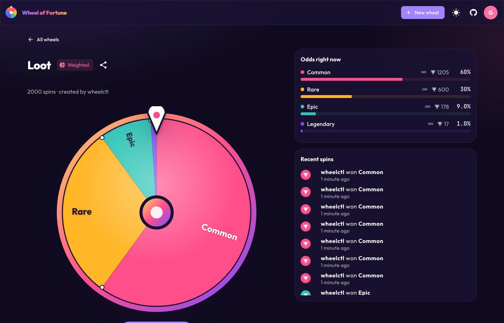
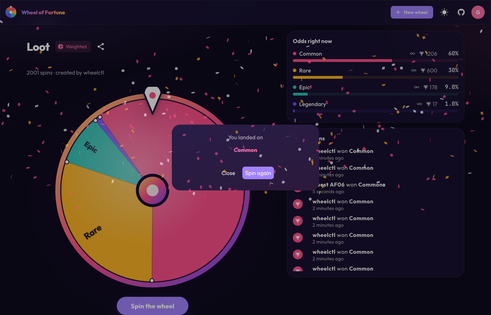
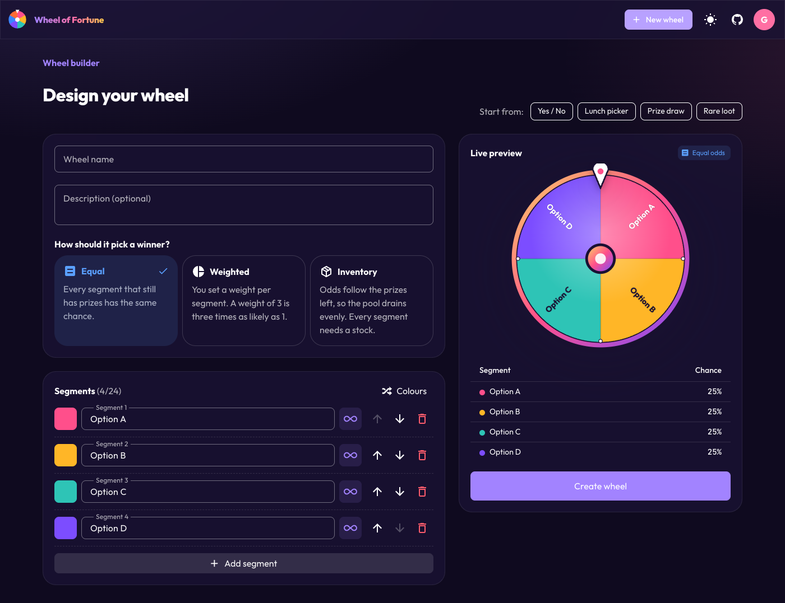
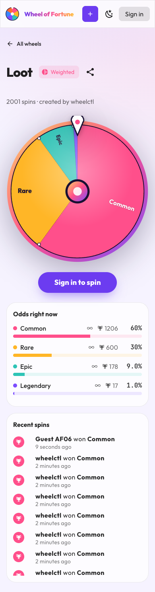

# 🎡 Wheel of Fortune

Build a wheel, share it, spin it. Every spin is settled **atomically in Redis**
by a Lua script, so the odds the UI shows are the odds you get, and limited
prizes can never be oversold, however many people spin at once.

> Originally built for the **Redis Hackathon (August 2022)**, in the *Wacky
> Wildcards* category: [dev.to post](https://dev.to/jackmcguire1/wheel-of-fortune-3521)
> · [Devpost](https://devpost.com/software/wheeloffortune). v2 is a ground-up
> modernisation of that entry; see [History](#history).



| Spin | Builder | Mobile (light) |
| --- | --- | --- |
|  |  |  |

## Features

- **Three ways to pick a winner**
  | Mode | Chance of a segment winning | Good for |
  | --- | --- | --- |
  | **Equal** | `1 / n` over the segments that still have prizes | Lunch pickers, yes/no |
  | **Weighted** | `weight / Σ weights` over available segments | Loot tables, "1 in 100" jackpots |
  | **Inventory** | `remaining / Σ remaining` | Raffles that should drain evenly |
- **Limited or unlimited stock per segment.** Out-of-stock segments drop out
  of the draw automatically. Owners can pause, resume, restock or delete.
- **Firebase Auth** with Google, email/password or guest sign-in. Local
  development runs fully on the **Auth emulator**; no Firebase project needed.
- **Live odds, win counts and a recent-spins feed** on every wheel.
- **One port, every protocol.** The Go server speaks Connect, gRPC and gRPC-Web
  directly, so there is no Envoy proxy any more.
- **`wheelctl`**, a CLI to create, spin (load test with concurrency), inspect
  and manage wheels.

## Architecture

```
 browser (Vue 3 + Vuetify, Vite)          wheelctl / grpcurl / any gRPC client
        │  Connect over HTTP + Firebase ID token        │  gRPC or Connect
        └──────────────────────┬─────────────────────────┘
                               ▼
                    cmd/server  :7755  (Go, connect-go)
                    ├─ internal/auth        verify Firebase ID tokens
                    ├─ internal/server      proto <-> domain, error codes
                    ├─ internal/wheel       rules, validation, ownership
                    └─ internal/wheel/redisstore
                               │  EVALSHA spin.lua (atomic pick + decrement)
                               ▼
                             Redis
  Firebase Auth emulator :9099 (UI :4000) ◄── browser sign-in, server token checks
```

| Path | What |
| --- | --- |
| `proto/wheel/v1/wheel.proto` | API contract; the single source of truth |
| `gen/`, `web/src/gen/` | Generated code (`make gen`); do not edit |
| `cmd/server` | API server |
| `cmd/wheelctl` | CLI client |
| `internal/wheel` | Domain types, odds rules (`Wheel.Weights`), `Service` |
| `internal/wheel/redisstore` | Redis store and `spin.lua` |
| `internal/auth` | Firebase verifier and Connect interceptor |
| `web/` | Frontend ([web/README.md](web/README.md)) |

### Redis layout

Keys are hash-tagged on the wheel id so a wheel's keys share a cluster slot.

| Key | Type | Contents |
| --- | --- | --- |
| `wheel:{id}:def` | string | JSON definition: name, mode, segments, owner |
| `wheel:{id}:state` | hash | `enabled` (0/1), `spins` |
| `wheel:{id}:stock` | hash | segment index → remaining prizes (limited segments only) |
| `wheel:{id}:wins` | hash | segment index → wins |
| `wheel:{id}:history` | list | last 100 spins as JSON, newest first |
| `wheels` | zset | wheel ids scored by creation time |

### How a spin works: one Lua script

The whole spin is [`spin.lua`](internal/wheel/redisstore/spin.lua), run with
`EVALSHA`. Redis runs a script to completion before serving any other command,
so read, decide and write happen as one step:

```
SpinWheel ──► Go: r = rand.Float64()        (randomness stays in Go, injectable in tests)
          ──► EVALSHA spin.lua  KEYS = def, state, stock, wins, history
                ├─ missing def?        → -1  NotFound
                ├─ state.enabled != 1? → -2  FailedPrecondition (paused)
                ├─ weight per segment, by mode:
                │     equal      1                if it has stock (or is unlimited)
                │     weighted   segment.weight   if it has stock (or is unlimited)
                │     inventory  remaining stock
                ├─ total == 0?         → -3  FailedPrecondition (out of prizes)
                ├─ walk the cumulative weights until r * total < sum → winner
                ├─ HINCRBY stock[winner] -1   (limited segments only)
                ├─ HINCRBY wins[winner] 1, HINCRBY state.spins 1
                └─ LPUSH + LTRIM history  → return winner index
```

Because nothing runs between the stock check and the decrement, a wheel can
never give away more prizes than it has. The store tests fire 20 concurrent
spins at a 15 prize wheel and expect exactly 15 wins. They also check that
weighted wheels land on their configured odds. The same weighting rules are in Go (`Wheel.Weights`, which reports odds
to clients) and in TypeScript (the builder preview). AGENTS.md lists what has
to stay in sync.

## Running locally

Prerequisites: [mise](https://mise.jdx.dev) (installs Go 1.27, Node 24, buf
and golangci-lint from `mise.toml`) and Docker. Without mise, install those
versions yourself.

```shell
make setup   # once: toolchain + web dependencies
make dev     # everything, in one go
```

`make dev` starts Redis and the Firebase Auth emulator in Docker (detached),
waits for them to be healthy, builds and runs the API, seeds three demo wheels
if Redis is empty, and runs the Vite dev server. Logs from both are shown with
`[api]` / `[web]` prefixes. Open **http://localhost:5173** and choose
*Play as a guest*.

- **Ctrl-C** stops the API and web. The containers keep running, so the next
  `make dev` starts instantly; `make down` stops them (and discards wheels).
- If port 6379 is taken (e.g. by another Redis), it picks the next free port.
  Set `REDIS_PORT` to choose one, or `SEED=0` to skip the demo wheels.
- Also running: the emulator UI on http://localhost:4000 (test users) and
  RedisInsight on http://localhost:8001 (browse the `wheel:{id}:*` keys).

Prefer separate terminals? `make deps`, `make server`, `make web` and
`make seed` do the individual steps.

To run the API in Docker as well: `docker compose --profile server up --build`.

### wheelctl

With `FIREBASE_AUTH_EMULATOR_HOST` set, `wheelctl` signs in to the emulator as
`cli@wheeloffortune.dev` (pass `-email` to act as someone else). Otherwise pass
a Firebase ID token with `-token` or `WHEEL_TOKEN`.

```shell
export FIREBASE_AUTH_EMULATOR_HOST=127.0.0.1:9099
alias wheelctl='go run ./cmd/wheelctl'

# segments are label[:weight[:stock]]; an empty stock means unlimited
wheelctl create -name "Loot box" -mode weighted -s Common:60 -s Rare:30 -s Epic:9 -s Legendary:1
wheelctl create -name "Raffle" -mode inventory -s "Headphones::1" -s "Mug::10"
wheelctl list
wheelctl spin -n 1000 -c 16 loot-box-abc123   # prints the observed distribution
wheelctl get loot-box-abc123
wheelctl history raffle-xyz789
wheelctl pause|resume|restock|delete <id>
```

The server also serves gRPC reflection and health checks, so
`grpcurl -plaintext localhost:7755 list` works.

### Configuration

| Flag | Env | Default |
| --- | --- | --- |
| `-addr` | `ADDR` | `:7755` |
| `-redis-url` | `REDIS_URL` | `redis://localhost:6379/0` |
| `-auth` | `AUTH_MODE` | `firebase` (`none`: every caller is one local user) |
| `-firebase-project` | `FIREBASE_PROJECT_ID` | `demo-wheeloffortune` |
| | `FIREBASE_AUTH_EMULATOR_HOST` | unset (set it to use the emulator) |
| `-cors-origins` | `CORS_ORIGINS` | `http://localhost:5173,http://127.0.0.1:5173` |
| `-log-level` | `LOG_LEVEL` | `info` |
| `-log-json` | `LOG_FORMAT=json` | text |

Frontend settings live in [`web/.env.example`](web/.env.example).

### Using real Firebase

1. Create a Firebase project and enable the Google, Email/Password and
   Anonymous providers.
2. Server: set `FIREBASE_PROJECT_ID` and leave `FIREBASE_AUTH_EMULATOR_HOST`
   unset. Verifying tokens only needs the project id.
3. Web: set `VITE_FIREBASE_API_KEY` and `VITE_FIREBASE_PROJECT_ID`, and set
   `VITE_FIREBASE_AUTH_EMULATOR_URL=` (empty).

## Development

```shell
make gen    # after editing proto/: buf lint + regenerate Go and TS
make test   # go test -race ./... and vitest
make lint   # buf lint, go vet, golangci-lint, vue-tsc
```

Store tests use in-process [miniredis](https://github.com/alicebob/miniredis)
by default. Set `TEST_REDIS_URL=redis://localhost:6379/15` to run them against
real Redis (this **flushes that DB**). CI does both lint and real-Redis tests,
and fails if generated code is stale.

## API

See [`proto/wheel/v1/wheel.proto`](proto/wheel/v1/wheel.proto). In short:

| RPC | Auth |
| --- | --- |
| `GetWheel`, `ListWheels`, `ListSpins` | public |
| `CreateWheel`, `SpinWheel` | any signed-in user (guests included) |
| `SetWheelEnabled`, `RestockWheel`, `DeleteWheel` | wheel owner |

Errors use standard codes: `invalid_argument` (validation), `not_found`,
`unauthenticated`, `permission_denied`, `failed_precondition` (paused or out of
prizes).

## History

**v1, August 2022:** a Redis Hackathon entry
([dev.to](https://dev.to/jackmcguire1/wheel-of-fortune-3521) ·
[Devpost](https://devpost.com/software/wheeloffortune)). A gRPC server spun
wheels with Lua scripts over `wheel:{name}:segment:{i}` counters, with an
admin CLI, a load-testing client, and a Vue 3 (Vue CLI) UI behind an Envoy
gRPC-Web proxy.

| v1 (2022) | v2 (2026) |
| --- | --- |
|  |  |

**v2, October 2026:** same core idea (spins settled atomically by a Redis Lua
script), modernised end to end:

| | v1 | v2 |
| --- | --- | --- |
| Go | 1.18, go-redis v9 beta | 1.27, go-redis v9, `log/slog`, `go tool` codegen |
| API | gRPC + Envoy proxy for browsers | Connect: gRPC, gRPC-Web and HTTP on one port, no proxy |
| Odds | weighted by remaining prizes | Equal, Weighted or Inventory per wheel; unlimited segments |
| Lua | `spin.lua` + `state.lua`, status checked outside the script | one `spin.lua` that checks, picks, decrements and records atomically |
| Wheels | named via the admin CLI, a fixed segment count for the whole server (default 5), UI hard-coded to `test` | users create any number of wheels in the UI or CLI, each with 2–24 named, coloured segments |
| Auth | none | Firebase Auth (emulator locally), owner-only admin actions |
| Frontend | Vue CLI + `vue3-fortune-wheel` | Vite, Vue 3.5, Vuetify 4, TypeScript, custom SVG wheel |
| CLI | `cmd/admin`, `cmd/client` | `wheelctl` (create, spin/load-test, history, pause, restock, …) |
| Dev loop | several terminals + protoc install | `make dev`; toolchain pinned with mise |
| Quality | no tests | unit, Redis (miniredis or real) and Connect tests, golangci-lint, CI |

## License

[Apache 2.0](LICENSE.md)
